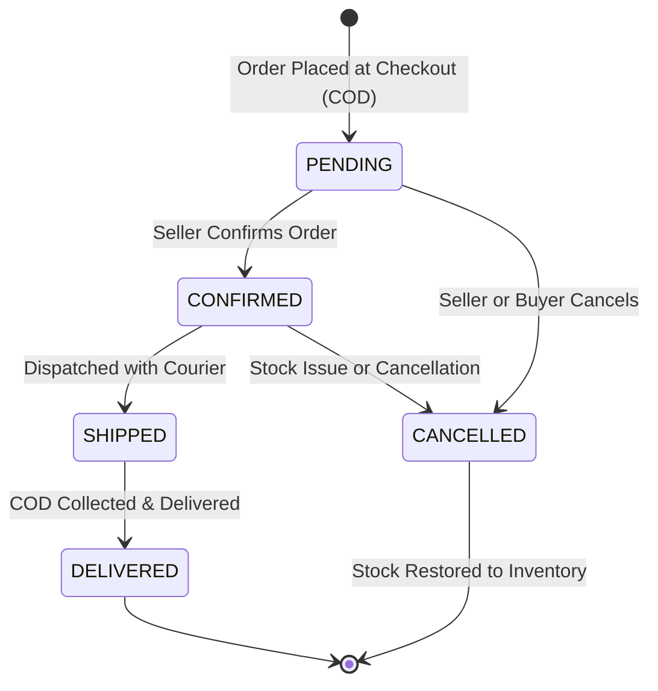

# Order Tracking Architecture & Fulfillment Workflow

This document details the architecture, security guarantees, privacy controls, and fulfillment lifecycle of the order tracking system in BoutiqueSaaS.

---

## 1. Architectural Overview & Security Model

In an e-commerce platform handling Cash on Delivery (COD) and direct WhatsApp orders, order tracking must balance shopper convenience with robust customer privacy and tenant data isolation.

### 1.1 Dual-Key Lookup Model
To prevent unauthorized browsing of customer orders, the public tracking endpoint enforces a **dual-key verification requirement**:
1. **Order Number:** The unique human-readable identifier assigned at checkout (e.g., `ORD-1729000000000-XYZ` or `ORD-1001`).
2. **Customer Mobile Number:** The 10-digit Indian phone number entered during checkout.

An order record is returned **only if both keys match and the order belongs to the specific boutique tenant (`storeId`)**.

### 1.2 Phone Number Normalization
To prevent lookup failures caused by formatting differences (e.g., spaces, dashes, `+91`, or leading zeros), phone numbers are normalized both client-side and server-side:
```javascript
let cleanPhone = phone.replace(/\D/g, '');
if (cleanPhone.length === 12 && cleanPhone.startsWith('91')) {
  cleanPhone = cleanPhone.slice(2);
} else if (cleanPhone.length === 11 && cleanPhone.startsWith('0')) {
  cleanPhone = cleanPhone.slice(1);
}
```

---

## 2. Customer Privacy & Data Protection

Public order tracking endpoints must never expose sensitive customer data that could facilitate identity theft or unauthorized surveillance.

### 2.1 Server-Side Field Projection & Redaction
In `orderService.js` (`getPublicOrderTracking`), data returned to the public endpoint is strictly filtered:

| Field | Public Exposure Status | Handling / Redaction |
| :--- | :--- | :--- |
| **Street Address / Door Number** | **Redacted** | Replaced with `'[Protected for customer privacy]'` |
| **City, State, Pincode** | **Visible** | Displayed to confirm shipment destination |
| **Customer Name** | **Visible** | Displayed for recipient verification |
| **Customer Phone** | **Partially Masked** | Masked (e.g., `98*****210`) to confirm the phone on file |
| **Internal Boutique Notes** | **Excluded** | Never returned to public endpoints |
| **Order Items & Variants** | **Visible** | Apparel item names, sizes, colors, and quantities |
| **Financial Summary** | **Visible** | Item total, discount applied, and final COD payable amount |
| **Order Status & Timestamps** | **Visible** | Current status and placement date |

---

## 3. Order Fulfillment State Machine

Every order follows an explicit, unidirectional state machine to maintain operational integrity:



### 3.1 Status Transitions & Rules
1. **`PENDING`:** Initial state upon checkout. Order details are saved, and stock is conditionally reserved.
2. **`CONFIRMED`:** The boutique seller verifies the order (optionally contacting the buyer via WhatsApp) and accepts it for packing.
3. **`SHIPPED`:** The parcel has been dispatched to the courier.
4. **`DELIVERED`:** The courier has delivered the apparel parcel and collected Cash on Delivery payment. Terminal positive state.
5. **`CANCELLED`:** If an order is rejected or cancelled:
   - Status transitions to `CANCELLED`.
   - The system automatically triggers atomic stock restoration for all ordered variants.
   - Terminal negative state. Further transitions are strictly prohibited.

---

## 4. Shopper Journey & Navigation Experience

### 4.1 Persistent Navigation Context
- **Highlighting Active Tab:** When on `/store/:slug/track`, the header navigation automatically marks the "Track Order" link with active background styling (`#ffe4e6`), primary color text, and `aria-current="page"`.
- **Back to Store Navigation:** The page includes a prominent **"← Back to [Store Name]"** button linking directly to `/store/:slug`, preserving the shopper's browsing session.

### 4.2 Direct WhatsApp Inquiry Integration
If an order is delayed or requires customer support, the tracking page provides a one-click **"Contact Boutique on WhatsApp"** button. The link opens a WhatsApp chat with the seller's verified number and pre-populates the order reference:
```
Hi [Boutique Name], I am checking status on my order #ORD-12345.
```
