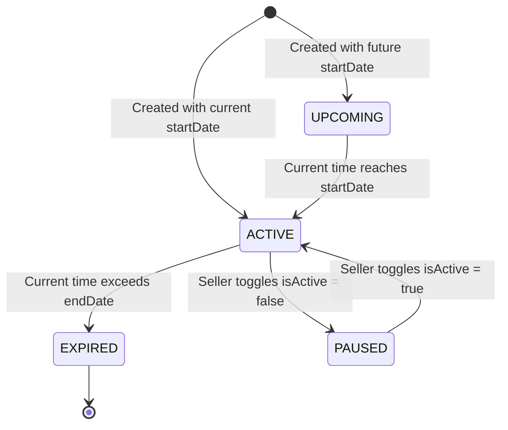

# Product and Promotion Workflow Guide

This document provides a comprehensive operational and technical guide for managing boutique apparel, size/color variants, and promotional campaigns in BoutiqueSaaS.

---

## 1. Product Lifecycle & Catalog Management

BoutiqueSaaS enables Indian clothing boutique owners and Instagram/WhatsApp sellers to manage apparel catalogs without technical assistance.

### 1.1 Creating a New Product
To list a new product, navigate to **Catalog & Products** (`/seller/products`) and click **Add New Product**.

#### Form Fields & Validation Rules
1. **Product Name (\*Required):**
   - Descriptive title (e.g., *"Chanderi Silk Embroidered Anarkali Kurti"*).
   - Automatically sanitized and transformed into a unique URL slug scoped to the store (e.g., `/products/chanderi-silk-embroidered-anarkali-kurti`).
2. **Category Selection & Custom Categories:**
   - **Default Categories:** *Kurtis, Sarees, Co-ord Sets, Lehengas, Suits & Anarkalis, Western Wear, Dresses, Dupattas & Shawls, Accessories*.
   - **Custom Categories:** Sellers can click **+ Create Custom Category** to define custom boutique categories (e.g., *"Bridal Lehengas"*, *"Organza Sarees"*, *"Silver Jewellery"*). Once created, the custom category is saved to the store and immediately selectable in dropdowns and storefront filters.
3. **Pricing Rules:**
   - **Selling Price (INR ₹) (\*Required):** Must be a positive integer greater than ₹0. Stored internally in integer minor units (**paise**: 1 INR = 100 paise).
   - **Original / MRP Price (INR ₹) (Optional):** Used to display a strikethrough price and calculate discount savings (e.g., *"25% OFF"*).
   - **Validation:** Original/MRP price must not be lower than the Selling Price. If a seller enters an MRP lower than the selling price, the system prevents submission with an informative error.
4. **Apparel Image URL & Quick Presets:**
   - Sellers can paste an image URL or choose from curated quick presets (*Banarasi Silk Saree*, *Embroidered Kurti*, *Party Lehenga*, *Chic Co-ord Set*, *Floral Dress*).
   - The form renders an immediate 42x42 thumbnail preview.
   - If an image link is broken or becomes unavailable, the system safely falls back to a category-specific SVG icon without breaking the layout.
5. **Apparel Description & Fabric Details:**
   - Detailed fabric description (e.g., weave, embroidery type, dupatta fabric, wash-care instructions).
6. **Size & Color Variants:**
   - Each variant specifies:
     - **Size:** S, M, L, XL, XXL, or Free Size.
     - **Color:** Shade name (e.g., *"Rani Pink"*, *"Bottle Green"*, *"Teal"*).
     - **Stock:** Available quantity (must be an integer $\ge 0$).
     - **SKU:** Autogenerated or custom inventory identifier.
   - Total product stock is the sum of all variant stocks.
7. **Publishing Status:**
   - Toggle **Publish immediately to public boutique storefront** to make the product live (`isPublished: true`) or keep it as a draft (`isPublished: false`).

---

## 2. Promotional Campaigns & Scheduled Sales Engine

Sellers can schedule real sales campaigns, festive promotions, and upcoming launch announcements that render directly on the public storefront.

### 2.1 Campaign Lifecycle States
The system dynamically computes campaign status based on real-time timestamps:



- **`UPCOMING`:** `now < startDate && isActive == true`. Displayed on the storefront with an honest **"Coming Soon • Starts [Date]"** badge.
- **`ACTIVE`:** `startDate <= now <= endDate && isActive == true`. Displayed prominently on the storefront. Shoppers clicking the card are automatically filtered to the relevant category.
- **`EXPIRED`:** `now > endDate`. Automatically deactivated from public view. Archived in the seller dashboard for performance reference.
- **`PAUSED`:** `isActive == false`. Temporarily hidden by the boutique owner.

### 2.2 Deal Types & Configuration
1. **Percentage Discount (`PERCENTAGE_DISCOUNT`):**
   - Applies a verified discount percentage (between 1% and 90%) across a category or the entire store.
2. **Price Cap (`PRICE_CAP`):**
   - Promotes budget-friendly items (e.g., *"Under ₹999 Clearance"*). Stored internally in paise (e.g., `99900`).
3. **Special Curated Collection (`SPECIAL_COLLECTION`):**
   - Highlights seasonal or festival collections (e.g., *"Festive Handloom Sarees"*).

### 2.3 Storefront Presentation Themes
Sellers can select from five curated gradient card themes:
- **Rose Gold:** `linear-gradient(135deg, #fff1f2 0%, #ffe4e6 100%)`, text `#be123c`
- **Royal Purple:** `linear-gradient(135deg, #faf5ff 0%, #f3e8ff 100%)`, text `#7e22ce`
- **Warm Amber:** `linear-gradient(135deg, #fffbeb 0%, #fef3c7 100%)`, text `#b45309`
- **Emerald Festive:** `linear-gradient(135deg, #ecfdf5 0%, #d1fae5 100%)`, text `#047857`
- **Indigo Silk:** `linear-gradient(135deg, #eef2ff 0%, #e0e7ff 100%)`, text `#4338ca`

---

## 3. Public Storefront Deals Engine (`/api/storefront/:slug/deals`)

The storefront deals engine eliminates fabricated promotional data. It returns genuine, verified offers:

1. **Active Seller Campaigns:** Returns campaigns created by the seller that are currently active.
2. **Upcoming Seller Campaigns:** Returns scheduled upcoming sales with an honest "Coming Soon" indicator.
3. **Verified Inventory Deals:** If the seller has not scheduled custom campaigns, the engine inspects live database inventory:
   - If genuine discounted products exist (`compareAtPricePaise > basePricePaise`), it computes the actual maximum discount percentage and counts discounted items.
   - If products priced under ₹999 exist, it calculates the authentic count.
4. **Honest Empty State:** If no campaigns and no discounts exist, fake percentages (e.g., "MIN. 50% OFF") are never shown. The storefront presents an authentic boutique greeting banner instead.

---

## 4. Multi-Tenant Isolation & Concurrency Safety

1. **Tenant Isolation:**
   - Every product and campaign operation requires valid seller session authentication (`requireAuth`) and verifies store ownership (`requireStoreScope`).
   - Lookups and mutations are scoped by `{ _id, storeId }`. Users cannot read, update, or delete another store's products or promotions by manipulating IDs or URL parameters.
2. **Atomic Inventory Reservation:**
   - During checkout, stock is decremented atomically using MongoDB's `$gte` conditional update:
     ```javascript
     const updateRes = await Product.updateOne(
       { _id: item.productId, 'variants._id': item.variantId, 'variants.stock': { $gte: item.quantity } },
       { $inc: { 'variants.$.stock': -item.quantity, totalStock: -item.quantity } }
     );
     ```
   - If concurrent requests attempt to purchase the last available unit, exactly one succeeds and the other receives an `Out of stock` error.
3. **Automatic Stock Restoration:**
   - When an order transitions to `CANCELLED`, the system restores variant and total stock counts atomically.
